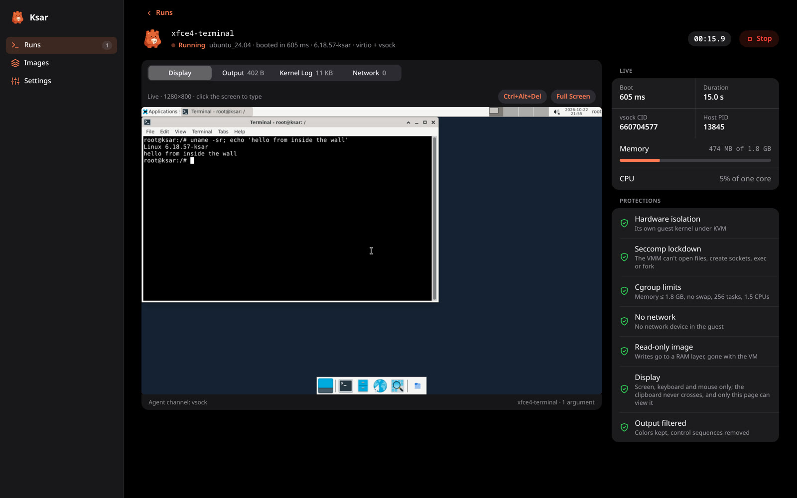
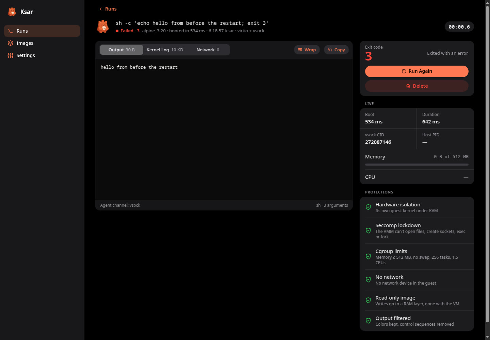
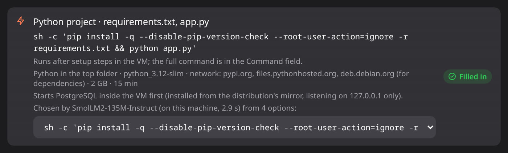

<h1 align="center">
  <br>
  Ksar
</h1>

<p align="center">
  <b>Run untrusted code in throwaway virtual machines, right from your browser.</b><br>
  One Go binary · its own hypervisor on KVM · no root · nothing kept
</p>

<p align="center">
  
</p>

Downloaded a repo you don't trust? An installer, a script from a gist, code an
AI agent just wrote? Run it in Ksar. Every run gets a fresh microVM that boots
in about half a second, sees nothing of your machine, has no network unless you
give it one, and is destroyed when it ends.

```sh
git clone https://github.com/Talfaza/ksar && cd ksar
make && make kernel
./ksar            # opens Ksar in your browser
```


> [!WARNING]
> Ksar is **alpha** software and has not had a security audit. It is built as
> defense in depth (see [Security](#security)), but don't bet anything critical
> on it yet.

## Highlights

- **Throwaway VMs in ~0.5 s.** Any Docker image becomes the guest's
  filesystem, read-only; everything a run writes lives in RAM and is gone
  afterwards.
- **Full Linux desktops in a browser tab.** Pick a display size and get Ubuntu,
  Debian, Fedora, Arch or Alpine with XFCE, usable with keyboard and mouse,
  about 4 seconds after you click Run.
- **Drop a project, press Run.** Ksar works out what a folder or archive is
  (Python, Node.js, Go, Rust, C, Make, shell, or several at once), picks the
  image, the command and the network it needs, and starts its database if it
  uses one. A tiny AI model, built in and running on your CPU, picks among the
  commands.
- **Secure by default.** No network card at all unless you ask; then only the
  hosts you allow, through a separate proxy. The hypervisor locks itself down
  with seccomp before your code runs.
- **Its own hypervisor.** Ksar talks to `/dev/kvm` directly: no QEMU, no
  Firecracker, no libvirt, no daemons. One static binary with its own guest
  kernel (2.5 MB) and guest agent.

## Contents

- [Getting started](#getting-started)
- [Using Ksar](#using-ksar): [runs](#runs) · [projects](#run-a-project) · [desktops](#desktops) · [network](#network) · [images](#images) · [history](#history)
- [Security](#security)
- [How it works](#how-it-works)
- [Performance](#performance)
- [Command line (optional)](#command-line-optional)
- [Development](#development)
- [Roadmap](#roadmap)

## Getting started

### Requirements

- **Linux on x86-64 with KVM.** Your user needs read and write access to
  `/dev/kvm`, usually through the `kvm` group:
  `sudo usermod -aG kvm $USER`, then log in again.
- **`/dev/vhost-vsock`** (`sudo modprobe vhost_vsock`).
- **Go 1.25+** and **erofs-utils** (`dnf install erofs-utils` / `apt install erofs-utils`).
- To build the guest kernel: `gcc make flex bison bc perl curl xz` and the
  libelf headers (`elfutils-libelf-devel` / `libelf-dev`).
- Optional: **Docker**, to import images; a **systemd user session**, for
  per-run CPU and memory limits.

Ksar never needs root, and refuses to run as root unless told to.

### Build and start

```sh
make          # ksar, with the guest agent embedded
make kernel   # the guest kernel -> build/bzImage (downloads Linux LTS, ~1–2 min)
./ksar        # serves the web UI on 127.0.0.1 and opens your browser
```

Then, in the page:

1. **Images → Import** an image from Docker, e.g. `alpine:3.20` or
   `python:3.12-slim`.
2. **New Run**, type a command, press **Run**. Or **Run a Project** and drop in
   a folder, `.zip` or `.tar.gz`.

`./ksar ui` does the same without opening a browser and prints the sign-in
link instead (handy over SSH). Settings shows a checklist of what Ksar found on
your machine.

## Using Ksar

### Runs



A run is an image, a command and a few limits. Its page streams the output
live (colors kept), and shows the guest kernel's log, memory and CPU, every
network connection, and the protections that actually applied to it. You can
type to the command's stdin, stop it, or run it again. Defaults are strict:
256 MB of memory, a 1-minute timeout and no network; Settings changes them.

### Run a project



**Run a Project** (or drop a folder or archive into any new run) and Ksar fills
in the run for you:

- **What it is.** Python (`requirements.txt`, `pyproject.toml`, entry points,
  tests), Node.js (`package.json` scripts), Go, Rust, C/C++ (even in a
  subfolder, even with Turbo C's `conio.h`), Make, or shell scripts. It looks
  three folders deep, so a Python API next to a Node front end is one project
  with two parts, and by default all parts run.
- **Where it runs.** The image each part needs (imported from Docker the first
  time), or one image with every runtime a top-level `run.sh` calls. When no
  image has both runtimes (Node.js with Go or Rust), the run installs the
  missing one first, from a pinned release checked by SHA-256.
- **What it may reach.** Only the package registries the install needs
  (`pypi.org`, `registry.npmjs.org`, `proxy.golang.org`, ...), and nothing at
  all for a project with no dependencies.
- **What it needs next to it.** A project that uses **MySQL, PostgreSQL or
  Redis** gets that server, installed from the image's own distribution and
  started inside the same VM on 127.0.0.1. If its `.env` or
  `docker-compose.yml` names a local database (a connection string, a URL,
  `DB_*` settings, or a compose service such as `db`), that user and database
  are created; otherwise `app`/`app`. `DATABASE_URL` and friends are set.
- **Friendly defaults.** Node runs get `CI=true` (no watch modes) and
  `HUSKY=0`; projects with git hooks get git and an empty repository; Python
  output isn't buffered.

The command is picked by **SmolLM2-135M-Instruct**, a small language model
that Ksar runs itself, in pure Go on the CPU (no GPU, no Ollama, no Python;
AVX2 where available). It's downloaded once from Settings (about 260 MB, a
pinned revision checked by SHA-256) and picks in about a second. It never
writes commands: Ksar builds the candidates from the project's files and the
model only ranks them, so a malicious README can't talk it into anything, and
it never decides the network policy. Without the model, rules pick.

Nothing from the project runs on your machine: detection only reads file names
and small manifests, and archives are unpacked with strict rules (paths stay
inside the folder, links and special files are skipped, size limits apply to
what they expand to). You can review and edit everything before pressing Run.

### Desktops

Pick a display size (1024 × 768 up to 1920 × 1080) and the run gets a screen,
keyboard and mouse, shown on its **Display** tab. Leave the command empty for
just the desktop, or name a program to open on it (e.g. `xfce4-terminal`).

Any Alpine, Debian, Ubuntu, Fedora or Arch image works, even one without X:
the first time, Ksar installs a minimal XFCE for it, inside a VM that can reach
only that distribution's package mirrors, and keeps the result as a read-only
layer. That takes a minute or more, once. **Prepare Desktop** on the Images
page does it ahead of time, so even the first display run starts in seconds.
After that, every desktop is fresh.

The screen path is deliberately simple: the guest draws into plain memory that
Ksar only reads, input only goes in, the clipboard never crosses, and only the
signed-in page can view the screen.

### Network

Runs have **no network card** unless you choose otherwise:

- **Off** (default): the guest has only `lo`.
- **Allow list**: only the hosts you list, e.g. `pypi.org`, `*.npmjs.org`,
  `github.com:443`.
- **Internet**: any public address.

Even with a network, the guest never touches your machine's network directly.
Its packets go to a separate, locked-down Ksar process running its own TCP/IP
stack (gVisor's netstack), which checks each DNS lookup and connection and
makes it again as an ordinary connection. Your local network, your machine's
own addresses and cloud metadata endpoints are always blocked, and DNS answers
pointing there are dropped. Every lookup and connection is listed on the run's
**Network** tab.

### Images

Images are root filesystems exported from Docker. Import any image by name on
the Images page (Docker needed for this step only), or put `docker export`
tars in `~/.local/share/ksar/images`. Each is converted once to a compressed
read-only disk (EROFS) and cached; the image's environment and working
directory are kept. Tested with Alpine, Debian, Ubuntu, Fedora, Arch and
language images (Python, Node.js, Go, GCC).

### History

Finished runs, with their output, stay after Ksar restarts (the latest 200, in
`~/.local/share/ksar/runs`, readable only by you). Delete a run from its page
or clear them all in Settings; `ksar ui -history ""` keeps nothing.

## Security

**Threat model:** the code in the VM is hostile and is root in the guest. It
controls the guest kernel, so it can send anything to Ksar's devices. The goal
is that it can't affect your machine beyond the CPU, memory and time it was
given, and that a bug in Ksar's device code doesn't hand it your machine.

Layers, from the inside out:

1. **Hardware virtualization.** The guest has its own kernel under KVM. Its
   only ways out are the few devices Ksar implements, and vhost-vsock.
2. **Small, validated device code.** Every value the guest controls (ring
   indexes, descriptor addresses and lengths, register writes, frame sizes) is
   checked before use, and all guest memory access goes through one
   bounds-checked function. Misbehaving queues are shut down. All of it is
   fuzzed.
3. **Lockdown.** Before the guest runs, Ksar restricts itself on every thread:
   a seccomp allowlist (no opening files, no sockets, no exec, no new
   processes, no executable memory; only the KVM and vhost ioctls it needs),
   `no_new_privs`, non-dumpable (no ptrace or `/proc/PID/mem` from your other
   processes), no core dumps.
4. **Limits.** Each run gets its own systemd scope: memory capped, no swap
   (guest memory never reaches disk), at most 256 tasks and 1.5 CPUs, and a
   timeout.
5. **Unprivileged.** Ksar needs only `/dev/kvm` and `/dev/vhost-vsock`.
6. **A trusted agent channel.** Only a connection from the VM's own vsock
   address, assigned by the kernel, is accepted as the guest agent.
7. **Output filtering.** Guest output shown in the page or a terminal keeps
   its colors, but clipboard writes, title changes and other control sequences
   are removed. It is never inserted as HTML.

**The web UI** listens on 127.0.0.1 only, checks the `Host` header (no DNS
rebinding) and the `Origin` of every request (other websites and other local
ports can't drive it), signs you in with a one-time link that sets an
`HttpOnly`, `SameSite=Strict` cookie, and has a strict Content-Security-Policy
with nothing loaded from the internet. It never runs guest code itself: each
run is a separate, locked-down `ksar run` process.

**Isolation between runs:** the image disk is read-only and every run gets a
fresh RAM layer, so nothing one run writes is seen by the next.

**Known limits:**

- No security audit has been done.
- The hypervisor is one process; a separate jailed process (namespaces, like
  Firecracker's jailer) would add a layer.
- vhost-vsock runs in the host kernel, so its bugs are kernel bugs: the price
  of its speed.
- "Internet" mode lets code reach anything public. Prefer an allow list.
- Database passwords read from a project's `.env` appear in its command, and
  so in your local run history.

Found a security problem? Please report it privately, as described in
[SECURITY.md](SECURITY.md).

Tested against hostile workloads, all contained: reaching the network, looking
for host files and SSH keys, writing to the image, fork bombs and infinite
loops, memory and disk exhaustion, kernel module loading, and terminal escape
injection.

## How it works

```
 ksar (one static Go process per run)
 ├── VMM ─────────── /dev/kvm: guest RAM, vCPU, in-kernel interrupt controller
 │   ├── virtio-blk              the image, read-only
 │   ├── vhost-vsock             the agent channel (data path in the host kernel)
 │   ├── virtio-net              only with a network: frames to the proxy
 │   ├── framebuffer + virtio-input   only with a display: screen, keyboard, tablet
 │   └── serial console, clock, reset line
 ├── session ◄──── vsock ────► ksar-agent (PID 1 in the guest)
 │                             RAM overlay on the image, runs the command
 └── ksar net-proxy (only with a network; its own process and seccomp filter)
     userspace TCP/IP (gVisor netstack), DNS, policy, connection log

 ksar ui  ── the web UI: starts each run as a ksar process, streams it to the page
```

1. **Image.** A Docker export becomes an EROFS disk once (`mkfs.erofs --tar`,
   no root needed), cached by content.
2. **Boot.** Ksar loads the guest kernel with the x86 64-bit boot protocol,
   sets up long mode and page tables itself and starts the vCPU. No BIOS, no
   PCI, no ACPI: devices are virtio-mmio, announced on the kernel command line.
3. **Root switch.** The agent mounts the image read-only under a tmpfs overlay
   and switches into it, so writes only ever reach RAM.
4. **Session.** The agent connects back over vsock with a small framed,
   flow-controlled protocol: files in, command, output, exit status.
5. **Teardown.** When the command exits, the VM is destroyed.

The guest kernel (`kernel/ksar.config`, on top of `tinyconfig`) is Linux LTS
with only what a sandbox needs: virtio, EROFS, overlayfs, tmpfs, namespaces,
seccomp, a framebuffer. No modules, PCI, ACPI or USB. It reaches userspace in
about 0.13 s.

## Performance

On a 16-core Intel laptop (Fedora 41):

| | Time |
|---|---|
| Boot, run a command, tear down | ~0.2–0.5 s |
| Click Run → usable Ubuntu XFCE desktop in the browser | ~4 s |
| First desktop for an image (one-time install, Debian) | ~40–50 s |
| 50 MB through stdin, checksummed | ~0.6 s |
| First use of a 400 MB image (disk conversion) | +0.9 s |
| A project with PostgreSQL or MySQL (install + start + run) | ~25–40 s |
| Network throughput through the proxy | ~50 MB/s |

Real test suites, run inside VMs: [more-itertools](https://github.com/more-itertools/more-itertools)
(765 tests + 21,194 subtests, 20 s), [node-semver](https://github.com/npm/node-semver)
(100% coverage, 38 s), [google/uuid](https://github.com/google/uuid) (17 s) and
[cJSON](https://github.com/DaveGamble/cJSON) (19/19, 8 s).

## Command line (optional)

Everything the page does is also a command, for scripts and terminals. The web
UI itself runs each run as a `ksar run` process.

```sh
ksar run -image build/alpine.tar -- sh -c 'echo "hello from $(cat /etc/alpine-release)"; exit 3'
# hello from 3.20.10      (exit code 3)

ksar run -mem 1G -image python.tar -copy ./myproject:/work -w /work -- python3 -m pytest
ksar run -net allow -allow pypi.org,files.pythonhosted.org -image python.tar -- pip install requests
ksar run -mem 1536M -timeout 30m -desktop -image ubuntu.tar -- xfce4-terminal
ksar ps                     # running VMs (from the CLI and the web UI)
ksar stop 34af              # stop one (any unique id prefix)
ksar suggest ./my-project   # how Ksar would run a project
```

<details>
<summary><b>All <code>ksar run</code> flags</b></summary>

| Flag | Default | Meaning |
|---|---|---|
| `-image FILE` | none | Root filesystem as a tar, e.g. from `docker export`. Without it, the guest has only the agent. |
| `-mem SIZE` | `256M` | Guest RAM (e.g. `512M`, `2G`; at most 3 GiB). Writes live in RAM too. |
| `-timeout D` | `1m` | Kill the VM after this long (`0` = never). |
| `-i` | off | Forward stdin to the command. |
| `-copy HOST:GUEST` | | Copy a file or directory in before running (repeatable). Symlinks are never followed. |
| `-e KEY=VALUE` | | Set an environment variable (repeatable). |
| `-w DIR` | `/` | Working directory in the guest. |
| `-net MODE` | `none` | `none` (no network card), `allow` (only `-allow` hosts) or `internet`. |
| `-allow RULE` | | With `-net allow`: `pypi.org`, `*.npmjs.org`, `github.com:443`, `1.2.3.4`, `10.1.0.0/16:8080` (repeatable or comma-separated). |
| `-display SIZE` | none | A screen, keyboard and mouse: `on` (1280x800) or e.g. `1920x1080`, served over VNC. |
| `-desktop` | off | Start X and XFCE (installing it once if needed), then COMMAND on the desktop. |
| `-vnc ADDR` | `127.0.0.1:0` | Where to serve VNC: `127.0.0.1:PORT` (a password is printed) or `unix:PATH`. |
| `-layer TAR` | | Stack a tar read-only on the image (repeatable, topmost first). |
| `-save-changes FILE` | | If COMMAND succeeds, save what it changed as a tar, usable with `-layer`. |
| `-id NAME` / `-label TEXT` | random | The VM's id and label in `ksar ps`. |
| `-v` | off | Show the guest kernel log, timings and the cgroup scope. |
| `-raw` | off | Don't filter control sequences in terminal output. |
| `-cgroup MODE` | `auto` | Per-run limits through a systemd user scope: `auto`, `on`, `off`. |
| `-kernel FILE` | auto | bzImage to boot. Without the Ksar kernel, a slower legacy mode works with any kernel. |
| `-lockdown` | on | The seccomp lockdown. Disable only to debug. |
| `-allow-root` | off | Allow running as root (not recommended). |

Exit codes follow `docker run`: the command's own code, or **124** timeout,
**125** Ksar failed, **126** not executable, **127** not found, **128+N**
killed by signal N.

</details>

<details>
<summary><b><code>ksar ui</code> flags</b></summary>

| Flag | Default | Meaning |
|---|---|---|
| `-addr` | `127.0.0.1:8765` | Listen address (loopback only; port 0 picks a free one). |
| `-images DIR` | `~/.local/share/ksar/images` | Image library (tars; symlinks allowed). |
| `-history DIR` | `~/.local/share/ksar/runs` | Where finished runs are kept; `""` keeps none. |
| `-kernel FILE` | auto | Kernel for runs. |
| `-open` | off | Open the browser (what plain `ksar` does). |

</details>

<details>
<summary><b>Image settings, VNC by hand, and other details</b></summary>

- **Image settings.** `docker export` drops the image's environment and
  working directory; Ksar reads them from an optional `NAME.tar.json` next to
  the tar, e.g. `{"env": ["PATH=/usr/local/go/bin:/usr/bin:/bin"], "workdir": "/src"}`.
  The web UI's Docker import writes it for you.
- **VNC.** `-display` without `-desktop` gives a bare screen for any image with
  Xorg; open the printed `vnc://` address in any VNC viewer.
  `examples/desktop` builds a small Alpine desktop image.
- **VM ids.** `ksar ps -a` also lists VMs that ended in the last hour; `-q`
  prints ids, `-json` everything. `ksar stop` sends SIGTERM, then SIGKILL after
  `-t` (5 s). Inside the guest, the id is in `/run/ksar/id`.
- **Writable space** is a RAM layer of up to half the guest's memory: give more
  `-mem` to commands that write a lot.
- **Caches** live in `~/.cache/ksar` (image disks, desktop layers); clearing
  them from Settings or by hand is always safe.

</details>

## Development

```sh
make test               # unit and end-to-end tests (needs KVM; uses build/bzImage and images in build/)
go test -race ./...     # race detector (lockdown checks are skipped: -race needs cgo)
make fuzz FUZZTIME=60s  # fuzz every parser of untrusted input
```

The end-to-end tests boot real VMs and check from outside that the lockdown
is in force on every thread. `KSAR_SECCOMP_DEBUG=1` turns blocked system calls
into errors instead of kills, for debugging only.

| Path | What |
|---|---|
| `cmd/ksar` | The `ksar` command: `ui`, `run`, `ps`, `stop`, `suggest` |
| `cmd/ksar-agent` | The guest agent, PID 1 in the VM |
| `internal/ui` | Web UI server and page (`web/`): runs, uploads, images, history |
| `internal/kvm`, `internal/vmm`, `internal/boot` | KVM, the VM loop, the x86 boot protocol |
| `internal/virtio`, `internal/devices` | virtio-mmio (blk, net, input, vsock), serial, clock |
| `internal/display` | VNC server over the guest framebuffer |
| `internal/netproxy` | Network proxy: netstack, DNS, policy, connection log |
| `internal/desktop` | XFCE install recipes and cached desktop layers |
| `internal/project` | Project detection: parts, images, commands, databases |
| `internal/llm` | Pure-Go SmolLM2 inference: tokenizer, quantized model, ranking |
| `internal/harden` | Seccomp filters, `no_new_privs`, non-dumpable |
| `internal/image`, `internal/initramfs` | Docker tar to EROFS, initramfs |
| `internal/sandbox`, `internal/agent` | One run end to end; the host–guest protocol |
| `internal/registry`, `internal/termsafe` | Running VMs for `ps`/`stop`; terminal output filter |
| `kernel/` | Guest kernel config and build script |

## Roadmap

- Multiple vCPUs per VM
- `ksar pull` and `ksar images`: manage images without Docker
- ioeventfd, and snapshots for even faster starts

## License

Ksar is licensed under the [Apache License 2.0](LICENSE). See [NOTICE](NOTICE)
for the software it includes. The guest kernel it builds is Linux (GPLv2),
downloaded and built from source by `make kernel`.
